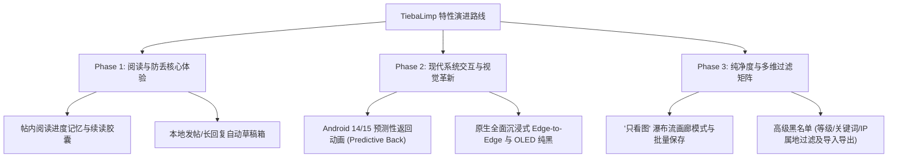

# TiebaLimp 功能演进路线图 (Feature Roadmap)

本文档规划并详细设计了 TiebaLimp 在后续版本中极具实现价值的 5 大核心功能特性。围绕**轻量、纯净、现代、流畅**的产品哲学，针对贴吧重度用户的深层痛点，提供系统化的架构方案与交互设计。

---

## 目录

1. [帖内阅读进度记忆与楼层书签](#1-帖内阅读进度记忆与楼层书签)
2. [高级黑名单与多维过滤系统](#2-高级黑名单与多维过滤系统)
3. [“只看图”画廊瀑布流模式](#3-只看图画廊瀑布流模式)
4. [预测性返回动画 (Predictive Back Gesture)](#4-预测性返回动画-predictive-back-gesture)
5. [全面沉浸式 Edge-to-Edge 视觉与深色模式打磨](#5-全面沉浸式-edge-to-edge-视觉与深色模式打磨)
6. [特性排期与优先级建议](#6-特性排期与优先级建议)

---

## 1. 帖内阅读进度记忆与楼层书签

### 1.1 痛点与场景
- 贴吧拥有海量长篇连载帖、游戏故事帖、图文攻略以及热门直播帖，页数常达数十乃至上百页。
- 用户中途退出客户端或切换应用后重新打开帖子，默认从第 1 页或第 1 楼重新加载，用户需要费力回忆并翻找历史楼层，造成严重的体验断层。

### 1.2 功能设计
- **自动进度持久化 (Auto Progress Saving)**：
  - 在 `ThreadPage` 列表中监听滑动状态（基于 `lazyListState.firstVisibleItemIndex` 及对应的数据项）。
  - 滑动停顿 800ms（防抖防频刷）后自动持久化当前帖子的阅读状态：
    - `threadId`: 帖子唯一 ID
    - `page`: 当前所在分页（页码）
    - `floor`: 当前可视楼层（如：第 42 楼）
    - `postId`: 当前楼层 PID
    - `readPercentage`: 阅读进度百分比
    - `updateTime`: 时间戳
  - 采用轻量级本地存储（Room 或 DataStore），保留最近阅读的 200 条帖子进度，遵循 LRU 自动回收。
- **续读悬浮胶囊 (Resume Reading Capsule)**：
  - 用户重新进入帖子详情页时，若检测到该帖存在历史阅读进度且位置大于第 1 楼，在屏幕底部操作栏上方优雅浮现 Material 3 胶囊提示条：
    > 📍 上次阅读到第 42 楼 (第 2 页) · [点击跳转] · [✕]
  - 点击跳转后，支持无感翻页并配合平滑滚动直接对齐到上次阅读的目标楼层。
- **自定义手动楼层书签 (Floor Bookmarks)**：
  - 楼层更多操作弹窗增加「添加书签」功能，允许用户添加简短备注（如“重要推论”、“关键证据”、“神回复留念”）。
  - 帖子右上角菜单提供「本帖书签」抽屉面板，一键检索并快速跳转。

---

## 2. 高级黑名单与多维过滤系统

### 2.1 痛点与场景
- 商业化贴吧环境中充斥着机器人小号批量水贴、引战言论、无意义刷屏营销号以及特定地域攻击。现有的简单作者拉黑机制无法应对复杂的网络噪音。

### 2.2 过滤维度设计
- **用户贴吧等级门限过滤 (User Level Shielding)**：
  - 支持配置“折叠/屏蔽低于指定等级（如 3 级或 4 级以下）用户发布的主帖与回复”。
  - 提供两种呈现形态：
    - *彻底隐藏*：完全不渲染；
    - *折叠收起*：显示一行紧凑的灰色折叠条（如：“已折叠来自 2 级账号的回复，点击展开”）。
- **多条件关键词与正则表达式过滤 (Keyword & Regex Filter)**：
  - 支持针对主帖标题、帖子正文、楼中楼评论分别配置黑名单词库；
  - 支持正则表达式匹配（精准拦截包含联系方式、变体微信号、广告引流词的推文）。
- **IP 属地精准过滤 (IP Region Filter)**：
  - 支持在设置中勾选屏蔽特定省份/地区的发言，消除无意义的地域引战。
- **媒体形态过滤 (Media Presence Filter)**：
  - 提供“只看有图主帖”选项，屏蔽大量纯文字短水贴。
- **规则配置共享 (Import & Export)**：
  - 过滤规则支持导出为轻量 JSON 格式（`tiebalimp_filter_rules.json`），用户可方便地备份或在社区与其他吧友共享高质量屏蔽词库。

---

## 3. “只看图”画廊瀑布流模式

### 3.1 痛点与场景
- 在动漫、壁纸、手办、摄影、插画、宠物等以视觉为核心的贴吧中，帖子里汇集了大量高清配图。
- 传统垂直长列表浏览方式中，大段楼层文字夹杂其间，且需频繁单张点开退出，看图效率极低。

### 3.2 交互与架构设计
- **双模形态一键切换 (Mode Toggle)**：
  - 在 `ThreadPage` 顶部工具栏增加视图切换按钮：**[文字楼层模式 ⇄ 画廊图集模式]**。
- **双列/三列瀑布流排版 (Compose Staggered Grid)**：
  - 切换至画廊模式后，基于 `LazyVerticalStaggeredGrid(columns = StaggeredGridCells.Fixed(2))` 呈现全帖所有高清配图。
  - 单图卡片展示原图宽高比自适应缩略图、所在楼层标识（如 `#12`）、作者昵称与点赞统计。
  - 滑动到底部时自动触发帖子分页拉取，实现无限流图片瀑布。
- **沉浸式画廊浏览体验 (Fullscreen Media Viewer)**：
  - 点击任一缩略图进入全屏沉浸画廊，支持多点触控无级缩放与双击放大；
  - 底部提供图片位置索引（如：`12 / 86`），左右滑动支持跨楼层连续看图；
  - 提供功能操作栏：**[查看原图]**、**[保存到本地相册]**、**[批量保存当前帖全部图片]**、**[定位到原楼层查看上下文]**。

---

## 4. 预测性返回动画 (Predictive Back Gesture)

### 4.1 痛点与场景
- Android 14+ (API 34) 与 Android 15 引入了规范化的**预测性返回手势**（Predictive Back Gesture）。
- 现代 Android 系统的原生手势交互中，用户从屏幕边缘内滑返回时能够实时预览上一级界面并拖拽缩放当前页面，若第三方客户端仍采用老式突然销毁切页，在主流系统（HyperOS, ColorOS, OriginOS, Pixel）上会有强烈的卡顿与生硬感。

### 4.2 技术方案与实现要点
- **Compose 官方集成**：
  - 引入 `androidx.activity:activity-compose` 中的 `PredictiveBackHandler` 拦截返回事件；
  - 捕获手势状态与物理进度值 `progress`（`0.0f` 到 `1.0f`）以及滑动手势来源边缘（左侧/右侧）。
- **流畅物理视觉反馈 (Motion & Physics)**：
  - **缩放与位移**：当前正在浏览的帖子卡片随着手势位移产生弹性微缩放（Scale: `1.0f` 降至 `0.92f`）；
  - **动态圆角平滑过渡**：页面矩形边缘平滑渐变为大圆角（`0.dp` 变换至 `24.dp`）；
  - **视差穿透揭示**：随着当前页面的收缩，底层的吧内帖子列表或主页面以 10%~15% 的轻微视差展开；
  - **动作判定**：若用户中途放弃手势（滑回屏幕边缘），卡片平滑回弹复原；若松手确认返回，卡片伴随自然惯性飞出并完成页面弹出。
- **深层手势扩展**：
  - 楼中楼底栏抽屉（BottomSheet）支持向下拖动预测性关闭；
  - 大图预览器支持手势下拉与侧滑预测性退出。

---

## 5. 全面沉浸式 Edge-to-Edge 视觉与深色模式打磨

### 5.1 痛点与场景
- Android 15 (targetSdk 35) 默认强制启用了全屏边缘延展（Edge-to-Edge）。未经深度适配的界面往往会在状态栏、药丸打孔屏或底部手势小白条区域出现突兀黑底、垫高异常或控件被手势栏遮挡的问题。
- 此外，OLED 屏幕在夜间使用纯黑背景（True Black / AMOLED Black）能够显著减少眼部疲劳并极大节省电池功耗。

### 5.2 视觉与技术方案
- **Edge-to-Edge 全面原生化**：
  - 彻底清理项目残存的弃用库（如 `accompanist/systemuicontroller`），主 Activity 统一由原生 `androidx.activity:enableEdgeToEdge()` 驱动。
  - 精细化运用 Compose 原生 Insets 体系：
    - 列表滚动流使用 `WindowInsets.systemBars` 并应用内容内边距（`contentPadding`），让帖子列表在上滑时自然沉入半透明磨砂状态栏与手势横条下方；
    - 底部输入栏、悬浮操作按钮与底栏严格遵循 `Modifier.navigationBarsPadding()` / `safeDrawingPadding()`，杜绝与系统手势横条重合误触。
- **AMOLED 极致纯黑与 Monet 动态取色融合**：
  - 在主题设置中支持切换**“深灰夜间 (Dark Gray)”**与**“极致纯黑 (Pure Black / OLED)”**；
  - 纯黑模式下背景设定为 `#000000`，楼层卡片采用高雅的微透明色相层（`surfaceVariant`），既省电又极具层次感；
  - 深度接入 Material You 动态取色算法，从用户壁纸中提取主调色，并柔和映射至发帖徽章、楼主标识、链接色彩与选项开关，提供浑然一体的现代系统质感。

---

## 6. 特性排期与优先级建议

| 优先级 | 功能模块 | 研发复杂度 | 体验收益 | 建议版本 |
| :---: | :--- | :---: | :---: | :---: |
| **P0** | **帖内阅读进度记忆与楼层书签** | 适中 | 极高（追更长帖必备） | `4.0.0-beta.2` |
| **P0** | **预测性返回动画 (Predictive Back)** | 适中 | 高（手势丝滑度质的飞跃） | `4.0.0-beta.2` |
| **P1** | **全面沉浸式 Edge-to-Edge 与纯黑适配** | 较易 | 高（Android 15 原生美感） | `4.0.0-beta.3` |
| **P1** | **高级黑名单与多维过滤系统** | 适中 | 极高（消除水军机器人与引战） | `4.1.0` |
| **P2** | **“只看图”画廊瀑布流模式** | 中等 | 高（图片帖/动漫吧绝佳利器） | `4.1.0` |
